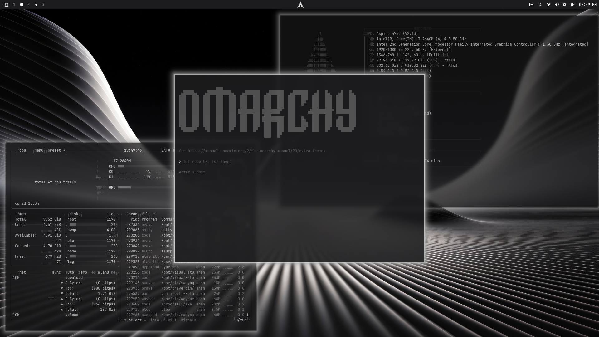

# nodaysidle Machina — Omarchy Theme

> *"Precision titanium, liquid mercury, and zero distraction."*

An industrial monochrome theme for **Omarchy / Hyprland**, custom-tailored for the **nodaysidle** ecosystem. Inspired by **omacarchy** and high-end industrial design (Mac Studio, Braun, Leica).

Designed for deep focus, long programming marathons, and zero eye fatigue. It replaces flashy saturated accents with subtle brushed silver gradients, obsidian surfaces, and razor-sharp typographic legibility.



---

## Design System & Color Tokens

Anchored in a matte obsidian titanium ground with liquid silver gradients and cold slate metadata:

| Token | Hex | Role in Ecosystem |
| :--- | :--- | :--- |
| **Matte Obsidian** | `#0E1013` | Primary pitch background (zero light bleed, anti-glare) |
| **Dark Obsidian** | `#090A0D` | Sunken containers, tooltips, and lock screen ground |
| **Graphite Surface** | `#181A20` | Elevated surfaces, menu cards, and container acrylic |
| **Liquid Silver** | `#E2E8F0` | Active window border, primary accent, focused highlights |
| **Titanium Steel** | `#CBD5E1` | Secondary metallic accent, active tab indicators |
| **Brushed Slate** | `#94A3B8` | Hairline separators, directory trees, telemetry stats |
| **Cold Slate** | `#64748B` | Inactive borders, metadata, code comments |
| **Crisp White** | `#F8FAFC` | Razor-sharp typography (JetBrains Mono Nerd Font) |

---

## Key Architectural Features

### 1. Liquid Silver Gradients
A surgical 2px border combining **Liquid Silver (`#E2E8F0`)**, **Brushed Titanium (`#94A3B8`)**, and **Platinum (`#CBD5E1`)** along a 135° diagonal gradient axis. Polished metallic edge highlights the active window with no looping animation overhead.

### 2. Industrial Squircle Geometry
Window geometry balances industrial precision with comfortable ergonomics (`rounding = 8`, `rounding_power = 2.5`), paired with subtle background blur (`size = 4, passes = 2`) and restrained drop shadows.

### 3. Ghostty & Herdr Cockpit Integration
Engineered from the ground up for **Ghostty** and the **Herdr** agent workspace multiplexer:
- Ghostty palette config with custom block cursor and selection highlights
- Live hot-reload support (`SIGUSR2`) on theme switch
- Matched window rules for `com.mitchellh.ghostty` and `title = "^Herdr.*"`

### 4. Bespoke Top Menu Bar Surfaces
`shell.toml` configures an architectural, monolithic status surface:
- **Matte Obsidian Bar**: `background = "#0E1013"` with smooth `alpha = 0.94`
- **Liquid Silver Rim**: Razor-thin border (`#242832`) separating the bar from the workspace
- **Crisp Titanium Nodes**: Active workspaces and telemetry stats rendered in `#E2E8F0`

### 5. Curated High-Resolution Wallpapers
Includes 6 bespoke 4K / ultra-wide wallpapers:
- `01-machina-silver-gradient.jpg`: Clean liquid silver gradient flow.
- `02-machina-graphite-flow.jpg`: Dark graphite aerodynamic wave.
- `03-machina-minimal-architecture.png`: Geometric architectural silver facade.
- `04-machina-titanium-shadow.png`: Brushed titanium shadow geometry.
- `05-machina-liquid-mercury.png`: 4K liquid mercury mesh.
- `06-machina-monolithic-facets.png`: 4K industrial graphite architectural facets.

---

## Installation & Activation

### 1. Register the Theme
Clone and run the installer from inside the repository:

```bash
git clone https://github.com/nodaysidle/omarchy-theme-nodaysidle-machina.git
cd omarchy-theme-nodaysidle-machina
chmod +x install uninstall hooks/nodaysidle-machina
./install
```

### 2. Activate with Omarchy
```bash
omarchy theme set nodaysidle-machina
```

### 3. Cycle Wallpapers
```bash
omarchy theme bg next
```
*(or press `Super + Ctrl + Space` for the visual wallpaper picker)*

---

## File Architecture

```
omarchy-theme-nodaysidle-machina/
├── colors.toml               # Master color tokens for Omarchy templates
├── hyprland.lua              # 135° liquid silver gradient, 8px squircle, machina glide
├── shell.toml                # Monolithic bar, controls, popups, and OSD
├── ghostty.conf              # Ghostty terminal palette & cursor definition
├── foot.ini                  # Foot terminal fallback config
├── btop.theme                # Telemetry skin for system monitoring
├── preview.png               # Screenshot for Omarchy theme picker
├── install / uninstall       # Symlink & hook registration scripts
├── hooks/
│   └── nodaysidle-machina    # Omarchy theme-set lifecycle hook
└── backgrounds/              # Six 4K / ultra-wide wallpapers
```

---

## Built for NODAYSIDLE
Part of the [nodaysidle](https://github.com/nodaysidle) workspace — relentless shipping, zero compromise.
